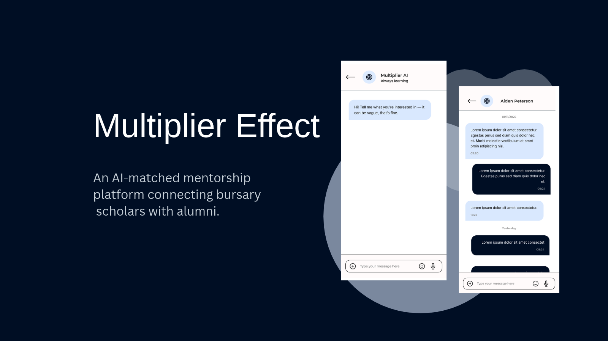
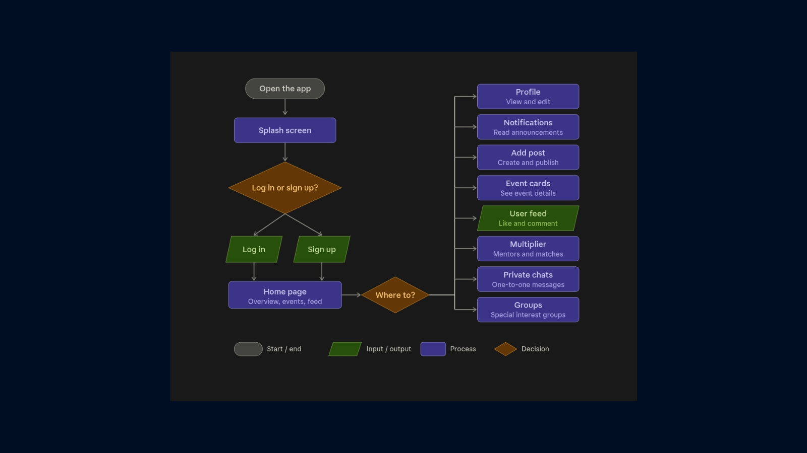
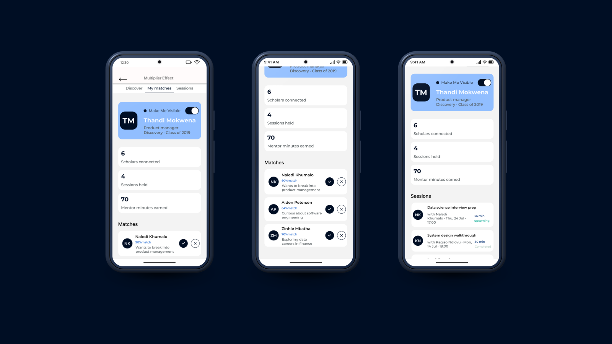

# The Multiplier App: UX/UI Case Study

**A platform that keeps foundation alumni and current students connected, so every success story helps create the next one.**

| | |
|---|---|
| **Role** | Volunteer UX/UI Designer |
| **Organisation** | Afrisol (education support foundation) |
| **Timeline** | 4 months |
| **Tools** | Figma |
| **Team** | Project lead, developers |
| **Status** | In development |

---

## 1. Overview

Afrisol is a foundation that selects and supports learners on their educational journey, but once those learners graduate, the connection often ends. The Multiplier app was conceived to change that: a space where alumni, current students and fellow alumni can connect, ask for help and mentor one another. The name comes from the idea of the *multiplier effect*, where each person who is helped goes on to help others.

I joined as the UX/UI designer. The project lead provided the vision and a brief, and my job was to bring it to life as a clear, usable and welcoming product.

**The brief required:**
- An AI chat to connect people with the right help
- Psychometric and aptitude tests for career guidance
- Private chat between users
- A way for alumni to show they are available for mentoring

---

## 2. The Problem

Through conversations with the project lead and developers, who were themselves supported by similar foundations, three problems stood out:

1. **Alumni lose touch.** After graduating, alumni drift away from the organisation and from each other.
2. **Students are unsure about their futures.** They often lack the tools and resources to choose a career. Many don't believe their dreams are attainable, and most simply don't know what the road ahead looks like.
3. **Alumni sometimes need to change direction too.** They don't realise another alumnus may have exactly the experience they need, because they've lost touch.

> **The core insight:** the knowledge people need already exists inside the community. It just isn't connected.

---

## 3. Goals

- Make it easy to **reconnect** alumni with each other and with students
- Help students **discover career paths** that suit them
- Make asking for help feel **simple and comfortable**
- Make **mentoring easy to offer and easy to find**

---

## 4. Research and Insights

Because the project lead and developers had lived the experience of being supported learners, their first-hand knowledge shaped much of my understanding. They filled gaps I had and helped me see the real emotional barriers: self-doubt, lack of information, and the feeling of being on your own.

These insights shaped three design principles:

| Insight | Design response |
|---|---|
| Alumni lose touch | Make reconnecting effortless, with mentoring availability visible |
| Students don't know the road ahead | Give guidance through tests and direct access to alumni who have walked it |
| People don't know who can help | Let an AI chat match needs to the right person |

---

## 5. Design Process

### User flows
I mapped how each user group would move through the app, so that students and alumni each get a journey that fits their needs.

### Wireframes
I started with low-fidelity wireframes in Figma to test structure and navigation before adding visual style.

### Key design decisions

**AI chat as the front door.** Instead of asking people to browse long lists of profiles, users simply say what they're struggling with. The AI responds by connecting alumni with people who can help, and students with alumni who can guide them. This lowers the barrier to asking for help.

**Tests that lead to action.** Students can take aptitude and psychometric tests, and the results point them toward career paths that suit them. This tackles the "I don't know my options" problem directly.

**Mentoring made visible.** Alumni can show when they are available to mentor, so students and other alumni know who to approach.

**Private chat for real conversations.** Once connected, users can talk one-on-one in a safe, direct space.

---

## 6. The Final Design

### AI chat

### Matching, Mentoring availability

### HOME FEED, EVENTS AND SETTINGS

---

## 7. Outcome

The app is **currently in development**. Feedback from the team has been positive: they felt the design brought their idea to life well, and that some of the screens showed them possibilities they hadn't imagined.

---

## 8. Reflections

- **Lived experience is powerful research.** Working with a team who had faced the same challenges as the users helped me design with empathy and focus on what matters.
- **Turning an idea into screens is a design skill in itself.** Translating a brief into flows and interfaces people can picture was where I added the most value.
- **Next steps:** user testing with real students and alumni once the build is ready, to validate the designs and refine them.

---

*Designed by Duduetsang as a volunteer project for Afrisol.*
